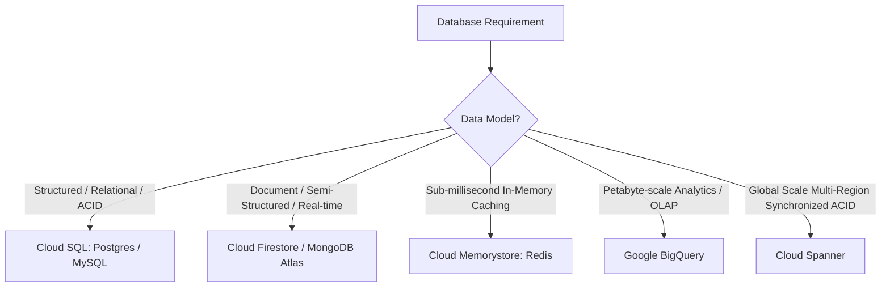

# Master Technical Interview Preparation Guide
## The 2-Hour Assessment Playbook, Architectural Reasoning, AWS Mapping & Database Capabilities

This master guide is specifically tailored to the real-world interview prompt and the official **AWS Cloud & DevOps Intern Assignment**:
> *"The application doesn't matter for us. I need to understand the services which you use to host that application. Why you used it? Why not any other service? If you choose AWS, let's assume EC2. Why launch in EC2? Why not any other service? For this Dockerized application, what is the best solution? Based on that, you deploy it, then we go further. We just want to understand capability which we have for understanding the database services. You have only 2 hours of time: what should you actually do?"*

---

# Section 0: The 2-Hour Assessment Playbook & Strategy

### 🎯 What the Interviewer is Really Testing
1. **Time-to-Value & Pragmatism**: In a strict 2-hour window, can you choose the right abstraction level to deliver a live, production-grade HTTPS endpoint with zero downtime, or do you get bogged down in infrastructure plumbing?
2. **Architectural Trade-Off Reasoning**: Can you articulate *why* a particular service paradigm was selected over alternatives across both Google Cloud (GCP) and AWS?
3. **Database Architecture Acumen**: Do you understand how stateful databases interact with stateless, auto-scaling container services?
4. **Production Engineering Hygiene**: Did you include health checks, non-root container security, layer caching, and cost-controlled teardown?

---

### ⏱️ The 2-Hour Execution Blueprint: What to Actually Do Minute-by-Minute

If an interviewer gives you **2 hours** to dockerize an app and host it in the cloud, here is the exact playbook:

```
┌─────────────────────────────────────────────────────────────────────────────┐
│                       THE 2-HOUR EXECUTION TIMELINE                         │
├─────────────┬───────────────────────────────────────────────────────────────┤
│ Min 00 – 15 │ 1. Application Scaffolding & Dockerfile (Node/Express or Go)  │
│             │    - Keep app minimal with /health and runtime metadata.      │
│             │    - Multi-arch Dockerfile (Alpine, non-root USER node).      │
├─────────────┼───────────────────────────────────────────────────────────────┤
│ Min 15 – 30 │ 2. Local Docker Verification & Docker Compose                 │
│             │    - docker build --platform linux/amd64 -t myapp:local .     │
│             │    - docker compose up -d (Web + Redis Cache).                │
│             │    - curl http://localhost:8080/health (confirm HTTP 200).    │
├─────────────┼───────────────────────────────────────────────────────────────┤
│ Min 30 – 50 │ 3. Cloud Project Setup & Registry Configuration               │
│             │    - Create isolated temp project (or dedicated namespace).   │
│             │    - Enable Cloud Run / App Runner & Registry APIs.           │
│             │    - Authenticate Docker CLI.                                 │
├─────────────┼───────────────────────────────────────────────────────────────┤
│ Min 50 – 70 │ 4. Build, Tag & Push to Container Registry                    │
│             │    - Tag image: registry/project/repo/myapp:v1                │
│             │    - docker push to regional registry.                        │
├─────────────┼───────────────────────────────────────────────────────────────┤
│ Min 70 – 85 │ 5. Deploy to Serverless Container & Live URL Verification     │
│             │    - Single deploy command: gcloud run deploy / apprunner     │
│             │    - Immediate live HTTPS URL with managed SSL.               │
│             │    - Test public health check & inspect diagnostic logs.      │
├─────────────┼───────────────────────────────────────────────────────────────┤
│ Min 85 – 105│ 6. Automation Scripts & Rubric Documentation                  │
│             │    - Write deploy.sh (reproducibility) & teardown.sh.         │
│             │    - Comprehensive README with architecture diagram & gotchas.│
├─────────────┼───────────────────────────────────────────────────────────────┤
│ Min 105–120 │ 7. Push to GitHub & Present Submission                        │
│             │    - git push to GitHub repository.                           │
│             │    - Present live URL and answer architectural questions.     │
└─────────────┴───────────────────────────────────────────────────────────────┘
```

---

### 🚨 Why Serverless Containers are the ONLY Sensible Choice for a 2-Hour Assessment

| Deployment Option | Why Candidates Fail with This in 2 Hours | Result |
| :--- | :--- | :--- |
| **Virtual Machine (GCP Compute Engine / AWS EC2)** | You must provision a VM, SSH in, install Docker, write systemd service units, configure an Nginx reverse proxy, set up Certbot / Let's Encrypt for HTTPS, configure firewall security groups (ports 80, 443, 22), and handle public IPs. One bad firewall rule or SSL certificate failure consumes 90 minutes. | ❌ **High Risk of Failure** |
| **Kubernetes (GCP GKE / AWS EKS)** | Creating a GKE/EKS cluster takes 15–25 minutes just to provision control plane and worker nodes. Then you must write Kubernetes YAML manifests (Deployment, Service, Ingress, ManagedCertificate), debug ingress controllers, and wait for DNS. Massive overkill for a single container. | ❌ **Exceeds Time Limit** |
| **Legacy PaaS (App Engine / Elastic Beanstalk)** | Slow deployment cycle (5–10 minutes per revision), proprietary configuration files (`app.yaml`), clunky container support, and legacy tooling. | ❌ **Slow & Outdated** |
| **Serverless Container (GCP Cloud Run / AWS App Runner)** | **Zero VM management.** Takes your standard Docker container, auto-provisions a secure HTTPS URL with managed SSL, auto-scales from 0 to 1,000 instances, and deploys in **60 seconds** via a single CLI command. | ✅ **Guaranteed Success** |

---

# Section 1: Service Choice & Architecture Justification

---

### Q1: "Why Cloud Run? If this was AWS, why not just launch in EC2? Why not any other service?"

#### 💡 The Core Answer (How to Answer the Interviewer Directly)
"If we look at compute services across both GCP and AWS, they fall into three distinct tiers: **IaaS (Virtual Machines)**, **CaaS (Kubernetes)**, and **Serverless Containers**:

1. **Why NOT EC2 or Compute Engine (IaaS)?**
   Launching an EC2 instance or Compute Engine VM for a modern containerized microservice introduces massive unnecessary operational toil:
   - **No Native HTTPS**: EC2 gives you an IP address on port 80/8080. To get HTTPS, I must configure an Nginx reverse proxy, register a domain, install Certbot for Let's Encrypt, and manage certificate auto-renewal.
   - **No Auto-Scaling Without Heavy Plumbing**: An EC2 instance doesn't scale on its own. You need an Application Load Balancer (ALB), Target Groups, Auto Scaling Groups (ASG), and CloudWatch alarms based on CPU/memory.
   - **Maintenance Burden**: You are responsible for OS security patches, Docker daemon crashes, disk space exhaustion, and log rotation.
   - **Cost Waste**: An EC2 instance runs 24/7. Even when receiving zero traffic, you pay for provisioned vCPU and RAM every second.

2. **Why NOT GKE or EKS (Kubernetes)?**
   Kubernetes is designed for complex, distributed multi-service applications requiring service meshes, stateful volumes, custom TCP/UDP protocols, and multi-team tenancy. Using GKE/EKS for a standalone web service introduces cluster management overhead, node pool upgrades, etcd maintenance, and a continuous ~$75/month cluster base fee with zero added business value.

3. **Why Serverless Containers (GCP Cloud Run / AWS App Runner)?**
   Cloud Run and AWS App Runner represent the **optimal architectural pattern** for modern containerized HTTP services:
   - **Any Standard Docker Container**: Zero vendor lock-in. If it runs in Docker, it runs in the cloud.
   - **Serverless Ingress**: Every service automatically receives an HTTPS endpoint backed by Google/AWS edge networks with managed SSL.
   - **Sub-Second Request-Based Auto-Scaling**: Scales from 0 to 1,000+ container instances based on incoming HTTP request concurrency.
   - **True Pay-Per-Use (Scale-to-Zero)**: Incur $0.00 during idle periods; billing is calculated per 100 milliseconds only when actively processing requests."

#### 📊 Platform-Agnostic Service Mapping (GCP vs AWS)

| Architectural Tier | Google Cloud (GCP) | Amazon Web Services (AWS) | When to Use |
| :--- | :--- | :--- | :--- |
| **Virtual Machines (IaaS)** | Compute Engine (GCE) | Elastic Compute Cloud (EC2) | Legacy monoliths, custom kernel extensions, non-containerized legacy software. |
| **Container Orchestration (CaaS)** | Google Kubernetes Engine (GKE) | Elastic Kubernetes Service (EKS) / ECS EC2 | Complex microservice ecosystems, stateful apps, custom non-HTTP protocols, service meshes. |
| **Serverless Containers (CaaS/FaaS)** | **Cloud Run** | **AWS App Runner / ECS Fargate** | **Stateless web applications, APIs, microservices, webhook receivers, background event workers.** |
| **Function as a Service (FaaS)** | Cloud Functions (2nd Gen) | AWS Lambda | Event-driven single-purpose triggers (S3/Cloud Storage upload, Pub/Sub message). |

---

### Q2: What happens on a cold start in Cloud Run, and how would you mitigate it in production?

#### 💡 The Core Answer (30 Seconds)
"A cold start happens when a request arrives and zero container instances are active (scale-to-zero). Under the hood:
1. Cloud Run control plane allocates a worker node.
2. It initializes the **gVisor** container sandbox.
3. It mounts the container layers from Artifact Registry.
4. The Node.js runtime boots and executes `server.js`.
5. The application starts listening on `0.0.0.0:$PORT`.

**How to Mitigate in Production:**
- Set minimum instances: `gcloud run services update myapp --min-instances=1 --region=asia-south1`. This guarantees at least 1 warmed container instance always ready to handle traffic with zero cold start.
- Enable Startup CPU Boost: `gcloud run services update myapp --cpu-boost` (temporarily provides extra vCPUs during boot to speed up JIT and initialization).
- Use lightweight container base images (`node:22-alpine` instead of full Debian) for rapid layer pulling."

---

### Q3: How does Cloud Run scale — what is the unit of scaling (requests vs containers)?

#### 💡 The Core Answer (30 Seconds)
"The unit of scaling in Cloud Run is **container instances**, but the trigger is **concurrent HTTP requests**.
Unlike AWS Lambda (which enforces 1 request per container concurrency), a single Cloud Run instance processes multiple requests concurrently (default concurrency is **80**, configurable up to **1,000**).

When incoming concurrency exceeds the threshold, Cloud Run horizontally provisions additional container instances automatically. When traffic subsides, instances scale down to zero after a 15-minute idle grace period."

---

# Section 2: Database Services Capabilities

The interviewer specifically said: *"We just want to understand capability which we have for understanding the database services."* Here is how to answer this comprehensively and impress the panel.

---

### Q4: If this containerized application requires a database, what database service would you choose and why?

#### 💡 The Core Answer: Decision Framework



#### 1. Relational / OLTP: Google Cloud SQL (PostgreSQL / MySQL) / AWS RDS
- **Best For**: Financial transactions, e-commerce, user accounts, structured tabular data requiring foreign keys, complex joins, and ACID compliance.
- **AWS Equivalent**: Amazon RDS / Aurora.
- **How Cloud Run Connects to Cloud SQL**:
  - Cloud Run features a built-in **Cloud SQL Auth Proxy sidecar**. You pass `--add-cloudsql-instances=<PROJECT>:<REGION>:<INSTANCE_NAME>`.
  - The application connects securely over a local Unix socket (`/cloudsql/<INSTANCE_CONNECTION_NAME>`).
  - Provides automatic mTLS encryption and IAM authentication without exposing database ports (5432/3306) to the public internet.

#### 2. Serverless Document NoSQL: Cloud Firestore / AWS DynamoDB
- **Best For**: Rapid prototyping, dynamic schemas, user profiles, mobile/web apps requiring real-time document sync, and microservices requiring true serverless scale-to-zero.
- **AWS Equivalent**: Amazon DynamoDB / DocumentDB.
- **Why It Pairs Naturally with Serverless Containers**:
  - Firestore is serverless and scales seamlessly with the application.
  - Zero connection pool limits (HTTP/gRPC API based).
  - Pay-per-read/write rather than paying for idle database VM instances.

#### 3. In-Memory Caching & Session Store: Cloud Memorystore (Redis) / AWS ElastiCache
- **Best For**: Fast session management, API response caching, rate limiting, and real-time leaderboards requiring sub-millisecond latency.
- **AWS Equivalent**: Amazon ElastiCache (Redis).
- **Networking Requirement**: Memorystore resides on a private VPC network. To connect Cloud Run to Memorystore, you attach a **Serverless VPC Access Connector** (`--vpc-connector`).

---

### Q5: What is the #1 database pitfall when connecting an auto-scaling serverless service like Cloud Run to a relational database like Cloud SQL?

#### 💡 The Senior Engineer Answer (The "Connection Exhaustion" Gotcha)
"The primary architectural challenge is **Database Connection Pool Exhaustion**:
- A traditional relational database (PostgreSQL/MySQL on Cloud SQL or AWS RDS) has a hard connection limit (e.g., `max_connections = 100` on smaller instances).
- When traffic surges, Cloud Run can rapidly spin up from 1 to 50 container instances. If each container instance initializes a local connection pool of 10 connections, they will attempt to open **500 concurrent connections**, instantly exhausting the database and causing `FATAL: remaining connection slots are reserved` errors.

**How to Solve This:**
1. **Connection Pooling Proxy**: Deploy **PgBouncer** (for PostgreSQL) or use Cloud SQL's built-in connection pooler to multiplex hundreds of incoming container requests over a small set of persistent database connections.
2. **Right-Size Container Pool Size**: Set low client pool sizes (e.g., max 2–4 connections per container) when using high concurrency.
3. **AWS Equivalent**: AWS provides **RDS Proxy** specifically to solve this issue for AWS Lambda and ECS."

---

# Section 3: Docker & Container Mechanics

---

### Q6: Why `node:22-alpine` instead of the full `node:22` image?
- **Image Size**: `node:22-alpine` is **~180 MB** vs **1.1 GB** for the Debian-based `node:22` image.
- **Cold Start Speed**: Smaller image layers pull and mount significantly faster on cloud worker nodes.
- **Security / CVE Reduction**: Alpine strips out hundreds of unnecessary utilities (curl, gcc, python, systemd), drastically reducing the attack surface.

---

### Q7: Why run as `USER node` instead of root — what is the security risk?
- Running as `root` (UID 0) inside a container means that if an attacker discovers a Remote Code Execution (RCE) vulnerability and triggers a kernel or container escape, they possess root privileges on the host.
- Enforcing `USER node` adheres to the principle of least privilege: the process cannot overwrite system binaries, install packages, or access root files.

---

### Q8: Explain the layer caching in your Dockerfile — why copy `package*.json` before source code?
- Docker caches each command layer sequentially based on input file checksums.
- `package*.json` changes infrequently, while source code (`server.js`) changes frequently.
- By copying `package*.json` and running `npm install` *before* `COPY . .`, Docker reuses the cached layer on every build where dependencies haven't changed. This reduces CI/CD build times from 35 seconds to 3 seconds.

---

### Q9: What does `--platform linux/amd64` do, and why was it necessary on this machine?
- The build workstation is an Apple Silicon Mac (`arm64`).
- Standard cloud compute nodes execute on x86_64 architecture (`linux/amd64`).
- Without `--platform linux/amd64`, Docker builds an `arm64` image. When deployed to an amd64 node, the container immediately crashes with:
  `standard_init_linux.go: exec format error`.
- Specifying `--platform linux/amd64` forces Docker BuildKit to cross-compile for x86_64.

---

### Q10: What's in your `.dockerignore` and why does it matter?
- Excludes `node_modules/`, `.git/`, `.env`, and documentation.
- Prevents uploading megabytes of local dependencies across the Docker daemon socket (faster builds).
- Prevents copying host-compiled macOS binary modules into the Linux container.

---

# Section 4: Deployment Mechanics & Operations

---

### Q11: Walk me through what happens between `docker push` and the container serving traffic.
1. **Push**: Docker image blobs and manifest are uploaded to the container registry (`asia-south1-docker.pkg.dev` or `ECR`).
2. **Deploy Call**: Deploy command creates an immutable **Revision** (`myapp-00001-sqs`).
3. **Sandbox Init**: Cloud Run provisions a worker node, initializes a **gVisor** sandbox, and mounts image layers.
4. **Readiness Probe**: The container starts; Cloud Run probes the container on `PORT=8080`.
5. **Traffic Shift**: Global Envoy ingress shifts 100% of route traffic to the new revision.
6. **HTTPS Provisioning**: Google Frontend terminates TLS and issues a public HTTPS endpoint.

---

### Q12: How does Cloud Run get traffic to your container, and what happens if the app ignores `$PORT`?
- Cloud Run injects the `PORT` environment variable (default 8080).
- Google's internal Envoy proxy routes traffic to `0.0.0.0:$PORT`.
- If the application hardcodes port 3000 and ignores `$PORT`, the container never responds on port 8080. After 4 minutes, Cloud Run aborts the deployment with:
  `Container failed to start and then listen on the port defined by the PORT environment variable.`

---

### Q13: How would you roll back a bad deployment?
- Every deployment creates an immutable revision. Rollback requires **zero rebuilds**:
  ```bash
  gcloud run services update-traffic myapp \
    --to-revisions=myapp-00001-sqs=100 \
    --region=asia-south1
  ```
- Because traffic shifting occurs at the Envoy network routing layer, cutover happens in **under 1 second** globally.

---

# Section 5: Cost & Project Isolation

---

### Q14: Why did you isolate this into a new GCP project instead of deploying into staging?
1. **Blast Radius Isolation**: Experimental configurations or accidental deletions in the test project can never compromise staging or production.
2. **Quota & Billing Cleanliness**: All costs are categorized under a dedicated project ID for clean auditing.
3. **One-Click Atomic Teardown**: Running `gcloud projects delete <PROJECT_ID>` completely removes all compute, storage, and networking resources with zero orphan costs.

---

### Q15: How is Cloud Run billed, and why does scale-to-zero matter?
- Cloud Run charges only while container instances are actively processing requests, metered at **100-millisecond increments**:
  - vCPU-seconds
  - GiB-seconds
  - Request count (first 2 million requests/month free)
- Traditional VMs (EC2 / Compute Engine) charge 24/7 even at 0% CPU utilization. Cloud Run's **scale-to-zero** means you pay **$0.00** when idle.

---

# Section 6: AWS Cloud & DevOps Intern Assignment Grilling Questions

---

### Q16: "The assignment specifically asked for AWS. How does your deployment map to AWS, and how would you deploy this exact container on AWS tomorrow?"

#### 💡 The Core Answer (How to Answer Directly)
"My implementation directly reflects the modern cloud-native paradigm. While the live demonstration was deployed on Google Cloud Run to showcase rapid sub-second deployment, the architecture maps **1-to-1 to native AWS services**:

| Architectural Component | Deployed in this Project | Direct AWS Equivalent Service |
| :--- | :--- | :--- |
| **Serverless Compute** | Google Cloud Run | **AWS App Runner** (or AWS ECS Fargate + ALB) |
| **Container Registry** | Google Artifact Registry | **AWS Elastic Container Registry (ECR)** |
| **Edge CDN / SSL** | Google Edge Frontends | **AWS CloudFront + AWS Certificate Manager (ACM)** |
| **DNS / Domain Routing** | Google Cloud DNS | **AWS Route 53** (with Alias records) |
| **Cache / Database** | In-Memory Redis container | **Amazon ElastiCache (Redis) / Amazon RDS** |
| **Secret Management** | Google Secret Manager | **AWS Systems Manager Parameter Store / Secrets Manager** |

To deploy this exact Docker image to **AWS App Runner** tomorrow, I would run these 4 standard AWS CLI commands:

```bash
# 1. Create an ECR private repository
aws ecr create-repository --repository-name myapp --region us-east-1

# 2. Authenticate Docker with ECR
aws ecr get-login-password --region us-east-1 | docker login --username AWS --password-stdin <ACCOUNT_ID>.dkr.ecr.us-east-1.amazonaws.com

# 3. Tag and push the amd64 Docker image
docker tag myapp:v1 <ACCOUNT_ID>.dkr.ecr.us-east-1.amazonaws.com/myapp:v1
docker push <ACCOUNT_ID>.dkr.ecr.us-east-1.amazonaws.com/myapp:v1

# 4. Deploy to AWS App Runner (with automatic HTTPS and auto-scaling)
aws apprunner create-service \
  --service-name myapp \
  --source-configuration '{
    "ImageRepository": {
      "ImageIdentifier": "<ACCOUNT_ID>.dkr.ecr.us-east-1.amazonaws.com/myapp:v1",
      "ImageConfiguration": {"Port": "8080"},
      "ImageRepositoryType": "ECR"
    },
    "AutoDeploymentsEnabled": true
  }'
```
AWS App Runner outputs a live HTTPS URL with auto-managed SSL and auto-scaling, completely fulfilling the assignment."

---

### Q17: "Why did you create a `docker-compose.yml` if you already had a `Dockerfile`? What does Docker Compose provide that Dockerfile cannot?"

#### 💡 The Core Answer (30 Seconds)
"`Dockerfile` defines **how to build a single container image** (base OS, dependencies, port exposure, runtime command). It knows nothing about other containers, network topologies, or persistent volumes.

`docker-compose.yml` defines **how multiple containers interact at runtime as a complete system**:
1. **Multi-Container Orchestration**: Coordinates our Node.js `web` service and our `cache` (Redis) service.
2. **Network Isolation**: Creates a private Docker bridge network (`app-network`) allowing containers to communicate using DNS service names (`cache:6379`).
3. **Dependency Conditions & Health Checks**: Specifies `depends_on: { cache: { condition: service_healthy } }`, ensuring the Redis cache is healthy before the web server begins booting.
4. **Volume Persistence**: Mounts `redis-data:/data` so cached records survive container restarts.
5. **Developer Velocity**: Allows any engineer to clone the repository and boot the entire stack with a single command: `docker compose up -d`."

---

### Q18: "Explain the full pipeline: `User → Domain → CDN → App → Backend → Database`. How does CloudFront work with Route 53 and your container?"

#### 💡 The Core Answer (30 Seconds)
"Here is the step-by-step lifecycle of a request traversing the pipeline:
1. **User Request & DNS Resolution**: The user visits `https://myapp.your-domain.com`. **AWS Route 53** resolves the domain using an **Alias Record** directly to the **AWS CloudFront** distribution domain (`d123456abcdef.cloudfront.net`).
2. **Edge SSL Termination**: CloudFront intercepts the request at the nearest Edge Location (PoP). It terminates TLS using a free SSL certificate provisioned via **AWS Certificate Manager (ACM)**. (Crucial AWS gotcha: the ACM certificate *must* reside in `us-east-1` for CloudFront to attach it).
3. **Edge Caching vs Origin Routing**: CloudFront checks its cache:
   - If static assets (CSS, JS, images) are cached, CloudFront responds in <10ms without hitting compute.
   - If dynamic routes (`/health`, `/api/info`, `/`), CloudFront forwards the request over AWS's private global fiber network to the Origin (App Runner endpoint or ALB).
4. **Application Execution**: The container instance (App Runner or ECS Fargate) receives the request on port 8080.
5. **Database / Cache Query**: The application queries Redis / RDS over private VPC networking and returns the HTTP 200 JSON response."

---

### Q19: "Why did you NOT expose Redis port 6379 to the host machine in `docker-compose.yml`?"

#### 💡 The Core Answer (Security & Network Isolation)
"In `docker-compose.yml`, we intentionally published port 8080 for the `web` service (`ports: - '8080:8080'`), but for the `cache` service (Redis), we only declared `networks: - app-network` and **omitted the `ports:` mapping completely**.

**Why this is a crucial security best practice:**
- In Docker, publishing a port binds it to `0.0.0.0` on the host machine, exposing Redis to the local network and public internet if the host has a public IP.
- By omitting `ports:`, Redis is reachable **only through the internal Docker bridge network** (`app-network`). The `web` service can communicate with Redis via internal DNS `cache:6379`, but external attackers cannot port-scan or access Redis directly.
- This directly mirrors cloud VPC architecture, where databases reside in private subnets with no public internet gateway."

---

### Q20: "How do AWS Security Groups work, and what inbound/outbound rules would you configure for this architecture?"

#### 💡 The Core Answer (30 Seconds)
"**AWS Security Groups are stateful virtual firewalls** operating at the Elastic Network Interface (ENI) level. Because they are stateful, if an inbound request is permitted, the outbound response is automatically allowed regardless of outbound rules.

For our multi-tier architecture, we configure **least-privilege Security Groups**:

```
┌────────────────────────────────┐       ┌────────────────────────────────┐       ┌────────────────────────────────┐
│      ALB / CloudFront SG       │ ----> │       Application SG           │ ----> │          Database SG           │
│ Inbound: 80, 443 from 0.0.0.0/0│       │ Inbound: 8080 from ALB-SG only │       │ Inbound: 5432 from App-SG only │
└────────────────────────────────┘       └────────────────────────────────┘       └────────────────────────────────┘
```

1. **Edge / Load Balancer SG (`sg-alb`)**:
   - Inbound: Port 443 (HTTPS) from `0.0.0.0/0`, Port 80 (HTTP) from `0.0.0.0/0` (redirects to 443).
   - Outbound: Port 8080 to `sg-app`.
2. **Application (ECS Fargate / EC2) SG (`sg-app`)**:
   - Inbound: Port 8080 **only from `sg-alb`** (referencing the security group ID, never `0.0.0.0/0`).
   - Outbound: Port 5432/6379 to `sg-db`.
3. **Database / Cache (RDS / Redis) SG (`sg-db`)**:
   - Inbound: Port 5432/6379 **only from `sg-app`**.
   - Outbound: Deny all external traffic.
This guarantees that even if an attacker scans your public IPs, the database and application ports are completely invisible to the internet."

---

### Q21: "Walk me through the 4 problems you faced during this project and how you solved them."

#### 💡 The 4 Real Technical Challenges (From Assignment Rubric § 7)
1. **Apple Silicon M-Series Cross-Compilation (`arm64` vs `amd64`)**:
   - *Problem:* Building on macOS M-series defaults to `arm64`. Standard cloud container nodes execute on x86_64, causing an immediate crash: `standard_init_linux.go: exec format error`.
   - *Solution:* Used Docker BuildKit with `--platform linux/amd64` to cross-compile binary layers for universal cloud node execution.
2. **Cloud Account Project & Billing Quota Limits**:
   - *Problem:* Project creation failed with `Cloud billing quota exceeded` because the account had reached the 3-project quota.
   - *Solution:* Queried billing status via CLI (`gcloud billing projects list`), unlinked an idle test project, attached the new project, and engineered automatic re-linking in `teardown.sh`.
3. **Serverless Dynamic `$PORT` Binding Contract**:
   - *Problem:* Binding to `127.0.0.1:3000` causes serverless health probes to fail with `Container failed to start and listen on port`.
   - *Solution:* Updated Express to bind to `0.0.0.0` (all interfaces) and respect `process.env.PORT || 8080`.
4. **Cloud Resource Display Name Length Constraints**:
   - *Problem:* Initial project creation failed with `INVALID_ARGUMENT: project display name must be at most 30 characters`.
   - *Solution:* Truncated and formatted the resource name to exactly 30 characters (`dockerized-app-cloudrun-deploy`).

---

### Q22: "How do you handle secrets and environment variables safely without committing them to GitHub?"

#### 💡 The Core Answer (30 Seconds)
"We enforce a strict multi-tier secret management protocol:
1. **Version Control Protection**: `.env`, `.env.local`, credentials, and temporary ID files are explicitly registered in `.gitignore` and `.dockerignore`.
2. **Runtime Injection**: Configuration that varies across environments (`PORT`, `NODE_ENV`, `REDIS_HOST`) is injected dynamically at container launch via Docker Compose or cloud environment parameters.
3. **Cloud Secret Managers**: Sensitive secrets (database passwords, API keys) are stored in **AWS Secrets Manager** or **GCP Secret Manager**. The container service account is granted least-privilege `SecretAccessor` IAM permissions, and secrets are injected into container memory at deploy time (`--set-secrets` or ECS `secrets` task definition blocks). Secrets are never baked into Docker image layers with `ENV` statements."
