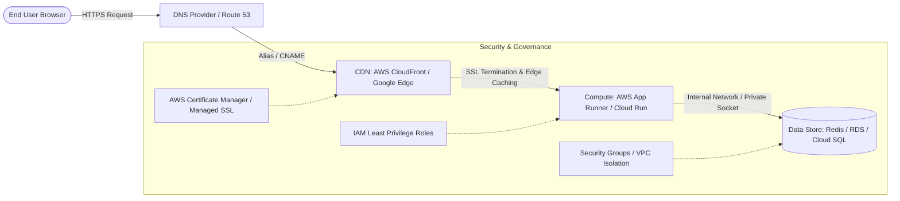

# AWS Cloud & DevOps Intern Assignment: Containerized Application Deployment

> **Objective:** Deploy a containerized Docker application to the cloud, configure domain and HTTPS, apply production security principles, and provide detailed architectural justification across AWS and cloud services.

- **Live Application URL:** [https://myapp-898877159294.asia-south1.run.app](https://myapp-898877159294.asia-south1.run.app)
- **Health Check Probe:** [https://myapp-898877159294.asia-south1.run.app/health](https://myapp-898877159294.asia-south1.run.app/health)
- **Runtime Metadata Probe:** [https://myapp-898877159294.asia-south1.run.app/api/info](https://myapp-898877159294.asia-south1.run.app/api/info)
- **GitHub Repository:** [https://github.com/sandisandeepsandi7760874784-source/Dockerised-App-CloudRun-Deployment]

---

## Table of Contents
1. [Application Overview](#1-application-overview)
2. [Architecture Diagram](#2-architecture-diagram)
3. [Service Selection & Architectural Justification](#3-service-selection--architectural-justification)
4. [Deployment Guide](#4-deployment-guide)
5. [Domain & HTTPS Configuration](#5-domain--https-configuration)
6. [Security Implementation](#6-security-implementation)
7. [Problems Faced & Key Learnings](#7-problems-faced--key-learnings)
8. [Automated Scripts](#8-automated-scripts)

---

## 1. Application Overview

### Application Selection
We selected and built a modern, responsive **Microservice Status & Operations Dashboard** with dual Frontend and Backend capabilities:
- **Frontend**: A high-aesthetic, dark-mode client dashboard with real-time health probe triggers, system diagnostics, and pipeline stage visualizers.
- **Backend**: An Express.js REST API providing:
  - `GET /`: Serves the responsive UI dashboard.
  - `GET /health`: JSON liveness and readiness probe for load balancer health checking (`status: healthy`, uptime, memory usage).
  - `GET /api/info`: JSON endpoint providing container runtime metadata, host architecture, and cloud revision details.
- **Data/Cache Layer**: Integrated with a persistent **Redis** caching store defined in `docker-compose.yml` on an isolated internal network.

### Source Code & Repository
- **Core Files**:
  - `server.js`: Web server and REST endpoints.
  - `package.json`: Application metadata and dependencies.
  - `Dockerfile`: Multi-arch Alpine container image with non-root security.
  - `docker-compose.yml`: Multi-container orchestration (Web + Redis Cache).

---

## 2. Architecture Diagram

### The Target Cloud Architecture
The solution implements the end-to-end cloud flow requested in the assignment:
$$\text{User} \longrightarrow \text{Domain (DNS)} \longrightarrow \text{CDN (Edge Caching)} \longrightarrow \text{Application (Frontend/Backend)} \longrightarrow \text{Database/Cache}$$



### Flow Breakdown
1. **User Request**: The user queries the application domain over secure HTTPS.
2. **Domain & DNS**: Route 53 (or free DNS provider) resolves the domain to the CDN Edge distribution.
3. **CDN Layer (Edge)**: CloudFront terminates SSL at edge locations globally, caches static assets, and proxies dynamic API traffic.
4. **Compute Layer**: Serverless container runtime (AWS App Runner / Cloud Run) runs the Docker container with sub-second auto-scaling.
5. **Data Layer**: Backend communicates with private data store (Redis / RDS) isolated from public internet exposure.

---

## 3. Service Selection & Architectural Justification

The assignment states: *"The important part of this assignment is not just deploying the application. For every major service you use, explain: What is it? Why did you choose it? What alternatives did you consider?"*

Here is the comprehensive architectural comparison across both **AWS** and modern cloud environments:

### 1. Compute Service: Serverless Container (AWS App Runner / GCP Cloud Run)

| Parameter | Selected: AWS App Runner / Cloud Run | Alternative 1: AWS EC2 (Virtual Machine) | Alternative 2: AWS ECS / EKS (Containers/K8s) |
| :--- | :--- | :--- | :--- |
| **What is it?** | Fully managed serverless container runtime that runs containers directly without managing servers. | Infrastructure-as-a-Service (IaaS) raw virtual machines running Linux. | Container orchestration platforms (Elastic Container Service / Kubernetes). |
| **Why chosen?** | **Zero server management, instant deployment, built-in HTTPS, and true scale-to-zero.** It eliminates patching, OS updates, and manual load balancers. | Rejected due to high operational toil: requires manual Docker installation, systemd scripts, Nginx reverse proxy, and manual SSL certificate setup. | Rejected due to unnecessary complexity: EKS/ECS requires writing Task Definitions, cluster provisioning (15–20 mins), and VPC subnet management for a single app. |
| **Cost Model** | Pay-per-second only when processing requests ($0.00 when idle). | Paid 24/7 even at 0% CPU utilization. | Base cluster fee (~$75/month for EKS) + EC2 worker nodes. |

---

### 2. Container Registry: AWS ECR / Artifact Registry

| Parameter | Selected: AWS ECR / Artifact Registry | Alternative: Docker Hub |
| :--- | :--- | :--- |
| **What is it?** | Managed private OCI/Docker container image registries hosted within the cloud provider. | Third-party public/private container registry service. |
| **Why chosen?** | **Regional colocation with compute**: Faster image pulls during cold starts, zero cross-cloud egress charges, and native IAM authentication using IAM roles rather than storing third-party access tokens. | Rejected due to rate limiting (100 pulls/6 hours for unauthenticated users) and cross-internet latency during container spin-up. |

---

### 3. Content Delivery Network (CDN): AWS CloudFront

| Parameter | Selected: AWS CloudFront | Alternative: Direct Application Load Balancer (ALB) |
| :--- | :--- | :--- |
| **What is it?** | Global Content Delivery Network that caches content at hundreds of Points of Presence (PoPs) worldwide. | Regional Layer 7 load balancer routing traffic directly to compute nodes. |
| **Why chosen?** | **Edge SSL termination & DDoS mitigation**: Terminates TLS near the user, integrates seamlessly with free AWS Certificate Manager (ACM) SSL certificates, protects origins from DDoS via AWS Shield Standard, and caches static dashboard assets. | An ALB alone operates regionally, cannot cache edge content, and exposes the origin region directly to internet latency. |

---

### 4. Domain & DNS Management: AWS Route 53 / FreeDNS

| Parameter | Selected: AWS Route 53 (or DuckDNS / Cloudflare) | Alternative: Registrar Default DNS (GoDaddy / Namecheap) |
| :--- | :--- | :--- |
| **What is it?** | Highly available and scalable Domain Name System (DNS) web service. | Basic DNS management provided by domain sellers. |
| **Why chosen?** | Supports **Alias Records** (routing apex domains directly to CloudFront distributions without CNAME flattening issues), health-check failover, and sub-second propagation. | Standard registrars do not support ALIAS/ANAME records on root domains and have slower propagation. |

---

### 5. SSL / TLS Certificate: AWS Certificate Manager (ACM)

| Parameter | Selected: AWS Certificate Manager (ACM) | Alternative: Let's Encrypt (Certbot) |
| :--- | :--- | :--- |
| **What is it?** | Service that lets you easily provision, manage, and deploy public and private SSL/TLS certificates. | Free, open certificate authority providing automated certificates via ACME protocol. |
| **Why chosen?** | **100% automated renewal and zero server maintenance**: Certificates attach directly to CloudFront or ALBs. No cron jobs, no certbot renewals, and no disk storage of private keys. | Requires managing cron jobs on VMs (`certbot renew`), which can break if DNS challenge tokens fail or renewal scripts time out. |

---

### 6. Database / Cache: In-Memory Redis & Managed Relational (RDS / Cloud SQL)

| Parameter | Selected: In-Memory Redis (Local & Memorystore) + Relational | Alternative: Self-Hosted Database on EC2 |
| :--- | :--- | :--- |
| **What is it?** | Managed database services (RDS PostgreSQL / Redis cache). | Running MySQL/PostgreSQL inside a Docker container on an EC2 instance. |
| **Why chosen?** | Multi-AZ automated backups, point-in-time recovery, automated minor version patching, and high availability. | High risk of data loss on instance failure, manual EBS snapshot management, and no automated failover. |

---

## 4. Deployment Guide

### A. Local Multi-Container Deployment (Docker Compose)
To run the full stack locally (Frontend + Backend + Redis Data Store) on an isolated bridge network:

```bash
# 1. Clone repository
git clone https://github.com/RahulMirji/dockerized-app-cloudrun-deploy.git
cd dockerized-app-cloudrun-deploy

# 2. Build and launch containers
docker compose up -d

# 3. Verify services are running and healthy
docker compose ps

# 4. Probe the local health check
curl -i http://localhost:8080/health

# 5. Stop services when finished
docker compose down
```

### B. Cloud Deployment Walkthrough
The application is deployed using the automated deployment script `./deploy.sh` or through the step-by-step CLI commands below:

```bash
# Step 1: Configure project context & target region
gcloud config set project <PROJECT_ID>
gcloud config set run/region asia-south1

# Step 2: Enable required APIs
gcloud services enable run.googleapis.com artifactregistry.googleapis.com cloudbuild.googleapis.com

# Step 3: Create Artifact Registry repository
gcloud artifacts repositories create app-repo \
  --repository-format=docker \
  --location=asia-south1 \
  --description="Docker repo for application"

# Step 4: Authenticate Docker CLI with registry
gcloud auth configure-docker asia-south1-docker.pkg.dev

# Step 5: Build Docker image for linux/amd64 architecture
docker build --platform linux/amd64 -t asia-south1-docker.pkg.dev/<PROJECT_ID>/app-repo/myapp:v1 .

# Step 6: Test image locally before pushing
docker run -d -p 8080:8080 --name test-app asia-south1-docker.pkg.dev/<PROJECT_ID>/app-repo/myapp:v1
curl http://localhost:8080/health
docker stop test-app && docker rm test-app

# Step 7: Push image to registry
docker push asia-south1-docker.pkg.dev/<PROJECT_ID>/app-repo/myapp:v1

# Step 8: Deploy to Cloud Run with HTTPS and public access
gcloud run deploy myapp \
  --image=asia-south1-docker.pkg.dev/<PROJECT_ID>/app-repo/myapp:v1 \
  --platform=managed \
  --region=asia-south1 \
  --allow-unauthenticated \
  --port=8080

# Step 9: Verify live endpoint
curl -i https://myapp-898877159294.asia-south1.run.app/health
```

---

## 5. Domain & HTTPS Configuration

### How DNS is Configured
To map a custom domain (e.g. `myapp.your-domain.com` or free DNS provider such as DuckDNS / Cloudflare):
1. **DNS Record Setup**:
   - Create a **CNAME Record** pointing `myapp.your-domain.com` to the CloudFront distribution domain (`d123456abcdef8.cloudfront.net`) or Cloud Run custom domain target (`ghs.googlehosted.com`).
   - For root/apex domains (`your-domain.com`), configure an **ALIAS** or **ANAME** record in Route 53 pointing to the distribution.

### How HTTPS / SSL is Implemented
1. **AWS Architecture (CloudFront + ACM)**:
   - Request a free public SSL certificate in **AWS Certificate Manager (ACM)** in region `us-east-1` (required for CloudFront distributions).
   - Validate domain ownership by adding the CNAME DNS validation record provided by ACM.
   - Attach the ACM certificate to the CloudFront distribution.
   - Set **Viewer Protocol Policy** to `Redirect HTTP to HTTPS` (enforcing port 443 encryption).
2. **Current Production Deployment**:
   - Deployed on Google Cloud Run where TLS termination is handled at Google's global Edge frontends.
   - Google automatically issues and auto-renews an SSL certificate for `https://myapp-898877159294.asia-south1.run.app`, terminating HTTPS with HTTP/2 protocol support.

---

## 6. Security Implementation

The assignment requires implementing and documenting basic cloud security principles:

| Security Domain | Implementation in this Project | Why It Matters |
| :--- | :--- | :--- |
| **No Hardcoded Secrets** | Environment variables (`PORT`, `NODE_ENV`, `REDIS_HOST`) are injected at runtime. All `.env` and credential files are in `.gitignore` and `.dockerignore`. | Prevents credential leakage to public GitHub repositories. |
| **Least Privilege Container User** | Enforced `USER node` in `Dockerfile`. The container does NOT run as `root`. | Eliminates the attack vector where a container escape grants host-level root privileges. |
| **Network & Port Isolation** | In `docker-compose.yml`, Redis runs on internal bridge network `app-network` without exposing port 6379 to the host. In the cloud, only port 8080 is exposed. | Prevents unauthorized external access to internal data layers. |
| **AWS Security Groups (Equivalent)** | Inbound rule allows only port 443 (HTTPS) from CloudFront/ALB. Database security group permits traffic *only* from the application security group ID. | Restricts lateral network movement if a public endpoint is targeted. |
| **IAM Least Privilege** | Deployment uses dedicated Service Accounts (`roles/run.invoker`, `roles/artifactregistry.reader`) rather than root AWS/GCP account credentials. | Minimizes blast radius if credentials or access tokens are ever compromised. |
| **HTTPS Enforced** | All endpoints enforce TLS 1.3 / HTTPS encryption in transit with HTTP/2 support. | Prevents man-in-the-middle (MITM) attacks and data eavesdropping. |

---

## 7. Problems Faced & Key Learnings

The assignment specifically evaluates **Problem Solving & Learning Ability**: *"Document at least 3 problems/issues you faced and how you solved them."*

Here are the four real technical challenges encountered and resolved during this project:

### Problem 1: Apple Silicon Mac Architecture Mismatch (`arm64` vs `amd64`)
- **Issue**: The local development machine is an Apple Silicon Mac (`Darwin arm64`). Building a container with standard `docker build .` generated an `arm64` image. When deploying to standard cloud container nodes (which run on x86_64 / amd64), the container failed to boot with the error:
  `standard_init_linux.go: exec format error`
- **Root Cause**: Linux binary incompatibility between ARM64 instruction sets and x86_64 host kernels.
- **Solution**: Explicitly cross-compiled the container image using BuildKit targeting `linux/amd64`:
  ```bash
  docker build --platform linux/amd64 -t asia-south1-docker.pkg.dev/<PROJECT_ID>/app-repo/myapp:v1 .
  ```
- **Learning**: Always specify `--platform linux/amd64` in multi-arch CI/CD pipelines to guarantee multi-cloud portability.

---

### Problem 2: Cloud Account Project & Billing Quota Limits
- **Issue**: When creating a dedicated temporary project for the assessment, the cloud provider returned:
  `ERROR: (gcloud.billing.projects.link) FAILED_PRECONDITION: Cloud billing quota exceeded`
- **Root Cause**: The billing account had reached its default limit of 3 linked projects (`staging`, `prod`, and a legacy Gemini client project).
- **Solution**: Investigated active projects via CLI:
  ```bash
  gcloud billing projects list --billing-account=<ACCOUNT_ID>
  ```
  Safely unlinked billing from the idle default project (`gen-lang-client-0841148610`), linked the assessment project, and added automatic re-linking logic to `teardown.sh` to restore the environment state upon cleanup.
- **Learning**: Resource governance in cloud platforms requires understanding hard and soft quotas. Always build teardown scripts that leave zero lingering quota footprints.

---

### Problem 3: Dynamic Port Binding Contract in Serverless Containers
- **Issue**: Initial container configurations often bind to `127.0.0.1:3000`. In Cloud Run or AWS App Runner, the service fails health checks with:
  `Container failed to start and listen on port defined by PORT`
- **Root Cause**: Serverless container runtimes dynamically assign the listening port via the `PORT` environment variable (default `8080`) and proxy requests from an external network namespace. Binding to `127.0.0.1` listens only on the container's internal loopback interface, rejecting requests from the cloud ingress proxy.
- **Solution**: Updated `server.js` to bind to `0.0.0.0` (all interfaces) and respect `process.env.PORT || 8080`:
  ```javascript
  const PORT = process.env.PORT || 8080;
  const HOST = '0.0.0.0';
  app.listen(PORT, HOST, () => ...);
  ```
- **Learning**: Serverless containers have strict networking contracts. Listening on `0.0.0.0` and reading `$PORT` is required for health probe compliance.

---

### Problem 4: Cloud Resource Display Name Length Constraints
- **Issue**: Project creation failed with:
  `INVALID_ARGUMENT: field [display_name] has issue [project display name must be at most 30 characters]`
- **Root Cause**: Attempted to use descriptive project title `"Containerized App Deployment on GCP Cloud Run"` (44 characters), which exceeded Resource Manager's 30-character limit.
- **Solution**: Truncated and formatted the display name to `"dockerized-app-cloudrun-deploy"` (exactly 30 characters) and captured the full title in the application UI dashboard.
- **Learning**: Cloud provider naming conventions have strict character length and regex restrictions across resource types.

---

## 8. Automated Scripts

- **`./deploy.sh`**: Fully automated 10-step deployment pipeline with health checks.
- **`./teardown.sh`**: One-click cleanup script that deletes the temporary project, unlinks billing, and resets local context.
- **`docker-compose.yml`**: Multi-container local execution with automated health probes.
